# 🏎️ Mustang Garage


<p align="center">
  <strong>Rare machines. Open roads. Stories worth keeping.</strong><br>
  An automotive journal, a curated collection, and the workspace behind it.
</p>

<p align="center">
  
  
  
  
  
  
</p>

<p align="center">
  <a href="#the-project">The project</a> &nbsp; / &nbsp;
  <a href="#screenshots">Screenshots</a> &nbsp; / &nbsp;
  <a href="#run-locally">Run locally</a> &nbsp; / &nbsp;
  <a href="#configuration">Configuration</a> &nbsp; / &nbsp;
  <a href="#deployment">Deployment</a>
</p>

---

<a name="the-project"></a>

## 🏁 The project

Mustang Garage brings the feeling of a classic motoring magazine to a full-stack web application. Cinematic photography, expressive serif headlines, olive charcoal surfaces, warm ivory, and restrained copper accents carry the experience from the public collection to the admin desk.

The frontend is built with React and TypeScript. An Express API stores inventory, editorial content, inquiries, subscriptions, and activity in MongoDB. Clerk handles accounts; the backend verifies administrator access.

### For the collector

| Experience | What it includes |
| --- | --- |
| **🚗 The collection** | Search by marque, model, or year; make and era filters; sorting; individual machine files. |
| **📖 The journal** | Cover stories, an editorial index, and article pages with readable long-form layouts. |
| **🔑 My garage** | A protected account dashboard, profile management, saved machines, and recently viewed cars. |
| **✉️ The conversation** | Contact-page and popup forms, optional car inquiries, and server-confirmed submission feedback. |
| **✨ The experience** | GSAP and ScrollTrigger motion, responsive navigation, keyboard focus states, and reduced-motion support. |

Wishlist selections currently last for the browsing session. Recently viewed cars use local browser storage when available.

### Behind the garage

The protected admin workspace includes inventory management, structured page editing, journal publishing, media uploads, subscriber management and CSV export, an inquiry inbox, reply drafts, account records, and recorded activity.

- **Publish deliberately.** Listed cars and published articles appear publicly. Page drafts preserve the last published version.
- **Keep the conversation.** Contact inquiries remain in MongoDB, including when a notification email fails.
- **Own the media.** Uploaded images are stored in MongoDB GridFS; published references prevent deletion.
- **Authorize on the server.** A verified Clerk session and an email in `ADMIN_EMAILS` are required for admin APIs. Hiding a navbar link is not the access-control mechanism.

<a name="screenshots"></a>

## 📸 Screenshots

All images below come from the checked-in [`MustangeCharger`](MustangeCharger/) folder. Select a preview to open the original screenshot.

### The editorial workspace

[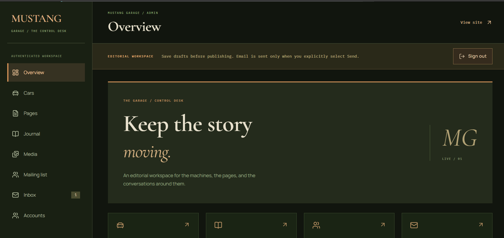](MustangeCharger/AdminOverView.png)

<table>
  <tr>
    <td width="50%"><strong>Inventory desk</strong><br><br><a href="MustangeCharger/CarPageAdmin.png">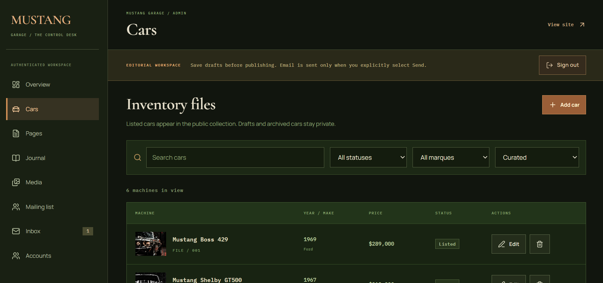</a></td>
    <td width="50%"><strong>The conversation desk</strong><br><br><a href="MustangeCharger/InboxAdmin.png">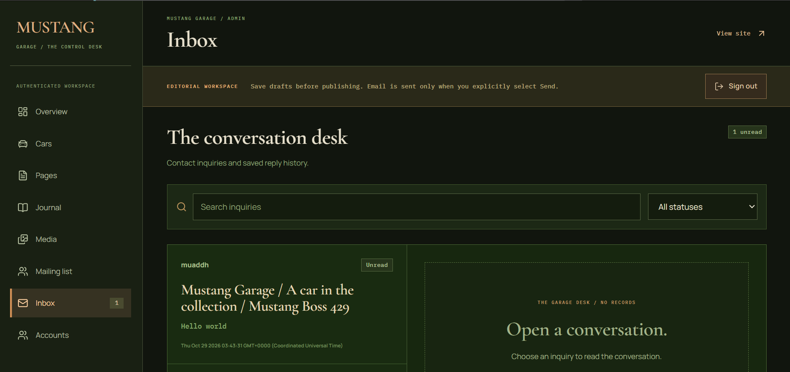</a></td>
  </tr>
  <tr>
    <td width="50%"><strong>Page content</strong><br><br><a href="MustangeCharger/ContentDesk.png">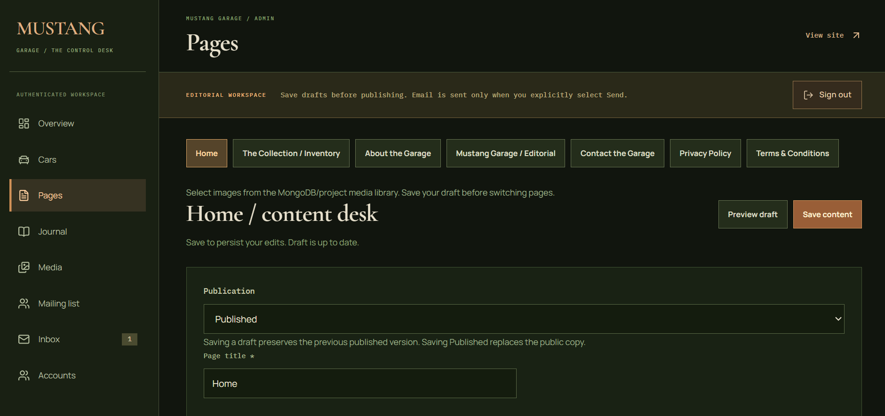</a></td>
    <td width="50%"><strong>The image archive</strong><br><br><a href="MustangeCharger/MediaAdminPage.png">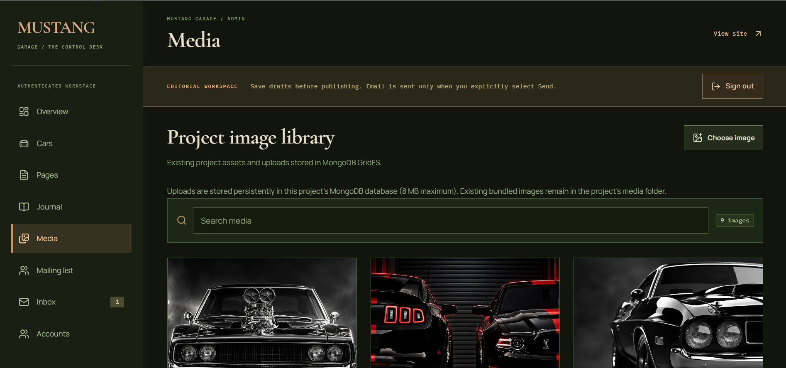</a></td>
  </tr>
</table>

### The public experience

<details>
<summary><strong>01 / Home — the complete editorial landing page</strong></summary>

[](MustangeCharger/HomePage.png)

</details>

<details>
<summary><strong>02 / Inventory — the curated collection</strong></summary>

[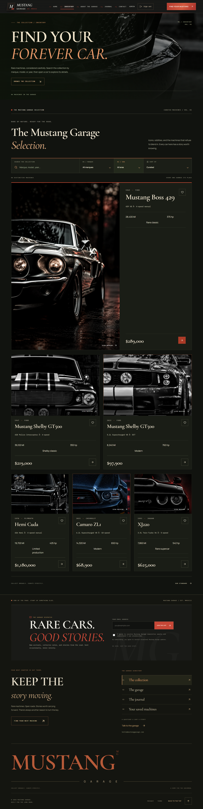](MustangeCharger/InvertoryPage.png)

</details>

<details>
<summary><strong>03 / About — the story and standards behind the garage</strong></summary>

[](MustangeCharger/AboutPage.png)

</details>

<details>
<summary><strong>04 / Journal — stories beyond the specification sheet</strong></summary>

[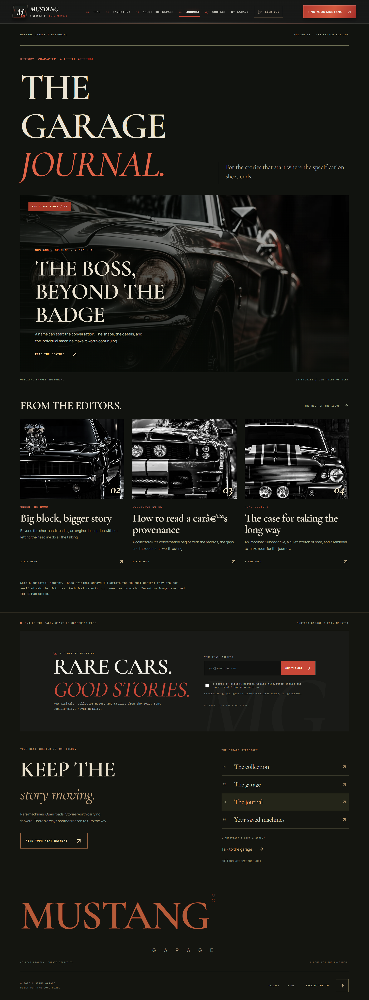](MustangeCharger/JournalPage.png)

</details>

<details>
<summary><strong>05 / Contact — start a conversation</strong></summary>

[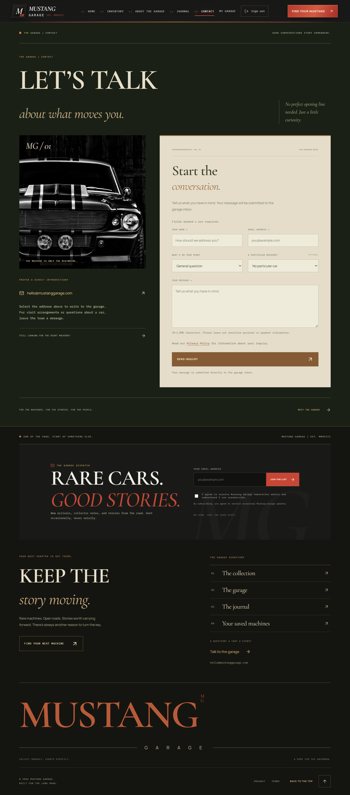](MustangeCharger/ContactPage.png)

</details>

<details>
<summary><strong>More from the control desk — forms, publishing, subscribers, and accounts</strong></summary>

<table>
  <tr>
    <td width="50%"><strong>Add a machine</strong><br><br><a href="MustangeCharger/AddCarFormAdmin.png">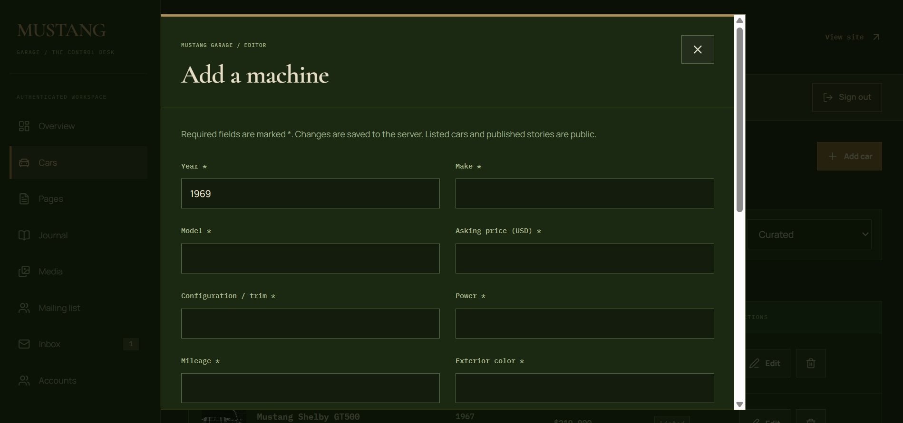</a></td>
    <td width="50%"><strong>Journal management</strong><br><br><a href="MustangeCharger/JornalPageAdmin.png">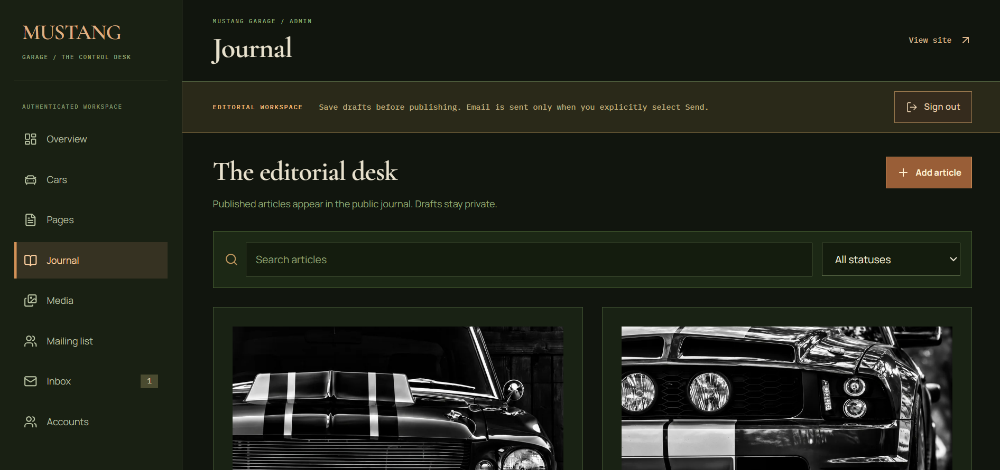</a></td>
  </tr>
  <tr>
    <td width="50%"><strong>Article editor</strong><br><br><a href="MustangeCharger/JornalFormPageAdmin.png">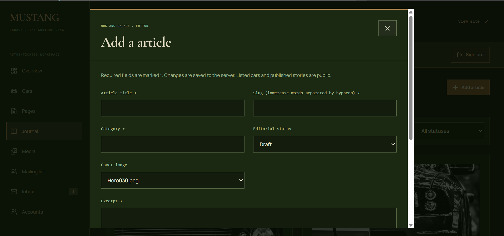</a></td>
    <td width="50%"><strong>Mailing list</strong><br><br><a href="MustangeCharger/MailListAdmin.png">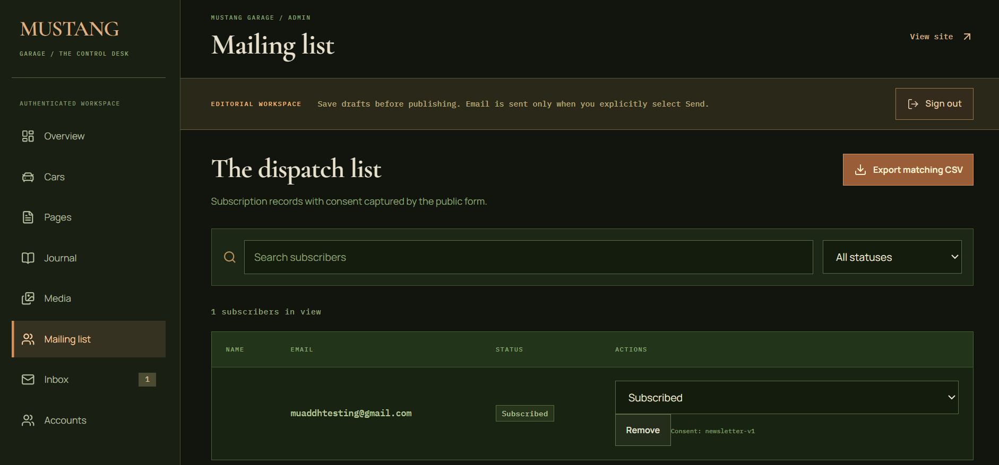</a></td>
  </tr>
  <tr>
    <td colspan="2"><strong>Accounts</strong><br><br><a href="MustangeCharger/LisAccountManagmentAdmin.png">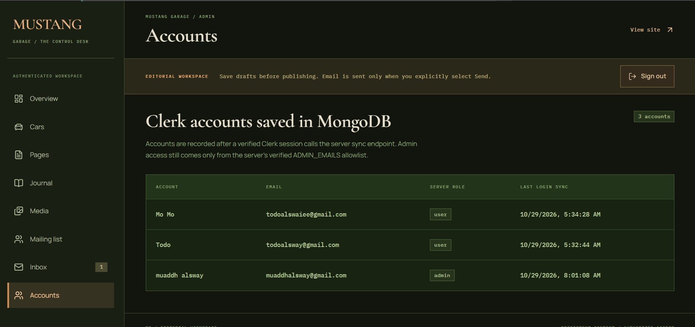</a></td>
  </tr>
</table>

</details>

<a name="built-with"></a>

## 🧰 Built with

| Layer | Technology |
| --- | --- |
| Interface | React 19, TypeScript, Vite, React Router |
| Design & motion | Component-scoped CSS, GSAP, ScrollTrigger, Lucide icons |
| Typography | Cormorant Garamond · Manrope · IBM Plex Mono |
| API | Node.js 22+, Express, TypeScript |
| Persistence | MongoDB, Mongoose, GridFS |
| Identity | Clerk sessions and backend email-allowlist authorization |
| Email | Resend contact notifications and explicit admin replies |
| Validation & protection | Zod, Helmet, CORS, form rate limits |
| API tests | Node test runner, Supertest, MongoDB Memory Server |

<a name="run-locally"></a>

## 🚀 Run locally

**You need:** Node.js 22 or newer, an accessible MongoDB database, and Clerk keys from the same Clerk application.

**1. Install dependencies from the repository root.**

```bash
npm --prefix backend ci
npm --prefix client ci
```

**2. Create the local environment files.**

Copy [`backend/.env.example`](backend/.env.example) to `backend/.env`, and [`client/.env.example`](client/.env.example) to `client/.env.local`. Replace the placeholders using the configuration table below. Environment files are ignored by Git.

**3. Start the API and frontend in separate terminals.**

```bash
# Terminal 1 — Express API
npm --prefix backend run dev
```

```bash
# Terminal 2 — Vite frontend
npm --prefix client run dev
```

Open [localhost:5173](http://localhost:5173). The API defaults to port `4000`; its readiness endpoint is [`/api/health`](http://localhost:4000/api/health).

### Optional seed data

```bash
npm --prefix backend run seed
```

The seed command inserts initial inventory and articles when their collections are empty, adds missing page content, and registers project images. Initial cars and articles are drafts by default. Review the database target and sample content before seeding or publishing.

```bash
# Publish cars and articles when inserting the initial seed records
npm --prefix backend run seed -- --publish
```

This flag does not publish existing drafts. Legal copy and sample editorial content still need appropriate review.

<a name="configuration"></a>

## ⚙️ Configuration

### Backend · `backend/.env`

| Variable | Purpose |
| --- | --- |
| `NODE_ENV` | `development` locally; `production` when deployed. |
| `PORT` | API port; defaults to `4000`. |
| `CLIENT_URL` | Exact frontend origins, comma-separated if needed. Wildcards are rejected in production. |
| `MONGODB_URI` | MongoDB connection string with the intended database and credentials. |
| `CLERK_SECRET_KEY` | Backend key from your Clerk application. |
| `ADMIN_EMAILS` | Comma-separated, verified administrator email addresses. |
| `RESEND_API_KEY` | Server-side Resend API key. |
| `RESEND_FROM_EMAIL` | Sender identity; the example uses `Mustang Garage <onboarding@resend.dev>`. |
| `CONTACT_NOTIFICATION_EMAIL` | Owner notification address. With the test sender, use the email registered to Resend. |
| `DNS_SERVERS` | Optional process-local DNS override for environments with Atlas SRV lookup problems. |

For MongoDB Atlas, create a database user with the required access to the selected database, URL-encode password characters in the URI, and allow the backend host through Atlas Network Access.

### Frontend · `client/.env.local`

| Variable | Local example |
| --- | --- |
| `VITE_API_URL` | `http://localhost:4000/api` |
| `VITE_CLERK_PUBLISHABLE_KEY` | Publishable key from the same Clerk application as the backend. |

Configure the exact frontend origin and sign-in redirects in Clerk. Regular users enter their personal garage; administrators are authorized by the backend allowlist.

> Only public configuration belongs in `VITE_` variables. Keep database credentials, Clerk secret keys, and Resend keys on the backend. Restart the relevant application after changing local environment values.

### How contact notifications work

```text
Visitor submits the contact form
                │
                ▼
       Inquiry saved to MongoDB
                │
          ┌─────┴─────┐
          ▼           ▼
     Admin inbox   Resend notification
                       │
                       ▼
              Configured owner email
              Reply-To: visitor email
```

The visitor cannot override the notification recipient. The inquiry remains in Admin → Inbox if notification delivery fails. Notification status and provider results are recorded; provider acceptance does not guarantee inbox delivery.

**No custom domain is required to notify the Resend account owner with the test sender.** Direct admin replies to other recipients require a verified sender domain. Admin reply drafts are saved before sending, and email is sent only after an explicit Send action. Images use MongoDB GridFS; there is no separate image-hosting service to configure.

<a name="routes--workspace"></a>

## 🗺️ Routes & workspace

| Public route | Page |
| --- | --- |
| `/` | Home |
| `/inventory` · `/inventory/:carId` | Collection and machine files |
| `/about` | About the Garage |
| `/journal` · `/journal/:slug` | Journal and individual stories |
| `/contact` | Contact page and inquiry form |
| `/saved` | Saved machines |
| `/account` | Signed-in user dashboard; `/dashboard` redirects here |
| `/sign-in` · `/sign-up` | Clerk account access |
| `/privacy` · `/terms` | Policy and terms content |

| Admin route | Desk |
| --- | --- |
| `/admin` | Overview and recent activity |
| `/admin/cars` | Inventory management |
| `/admin/pages` | Page content and publication |
| `/admin/journal` | Article management |
| `/admin/media` | Image library and uploads |
| `/admin/mailing` | Subscribers and CSV export |
| `/admin/inbox` | Inquiries, reply drafts, and sent-message history |
| `/admin/users` | Account records |

The API is mounted under `/api/public`, `/api/auth`, and `/api/admin`. Public inventory and journal endpoints expose listed/published content. Contact and newsletter endpoints validate input and apply rate limits; admin list endpoints support pagination.

<details>
<summary><strong>Data models</strong></summary>

`Car` · `Article` · `Page` · `Subscriber` · `Inquiry` · `EmailReply` · `Media` · `User` · `Activity` · `Counter`

Uploaded image files and chunks live in GridFS. Page records keep editable content separate from their last published snapshot. Inquiries retain their notification metadata and associated reply records.

</details>

<a name="project-structure"></a>

## 🗂️ Project structure

```text
MustangeEra/
├── client/
│   ├── public/                  # Favicon and public assets
│   ├── src/
│   │   ├── admin/               # Protected editorial workspace
│   │   ├── components/          # Home, About, inventory, and shared UI
│   │   ├── features/            # Inventory, journal, and legal types/content
│   │   ├── lib/                 # API client, authentication, shared state
│   │   ├── pages/               # Account, journal, and legal pages
│   │   └── styles/              # Scoped CSS and typography theme
│   └── vercel.json              # SPA route rewrites
├── backend/
│   ├── public/media/            # Project image assets
│   ├── src/
│   │   ├── controllers/         # Public content and contact handling
│   │   ├── email/               # Reply templates and contact notifications
│   │   ├── middleware/          # Authentication and error handling
│   │   ├── models/              # Mongoose schemas
│   │   ├── routes/              # Express API routes
│   │   └── seed.ts              # Initial content and asset registration
│   └── test/                    # API integration tests
├── MustangeCharger/             # README hero and screenshots
├── render.yaml                 # Backend deployment blueprint
└── README.md
```

<a name="quality-checks"></a>

## ✅ Quality checks

Run from the repository root:

```bash
npm --prefix client run lint
npm --prefix client run build
npm --prefix backend run build
npm --prefix backend test
```

The backend tests use a disposable MongoDB instance and fake email delivery. The first test run may download a MongoDB binary; `MONGOMS_SYSTEM_BINARY` can point to an installed `mongod` executable instead. Tests do not need to send real emails or modify your application database.

<a name="deployment"></a>

## ☁️ Deployment

The repository includes a [Render Blueprint](render.yaml) for the API and [Vercel rewrites](client/vercel.json) for frontend routes.

1. **Frontend:** set the project root to `client`, build with `npm run build`, and use `dist` as the output directory. Add the frontend environment variables.
2. **Backend:** deploy the root `render.yaml` blueprint, which uses `backend` as its application directory. Supply MongoDB, Clerk, admin, CORS, and email settings through the hosting dashboard.
3. **Connect them:** set frontend `VITE_API_URL` to the deployed backend origin followed by `/api`. Set backend `CLIENT_URL` to the exact frontend origin and allow that origin in Clerk.
4. **Verify readiness:** check `/api/health`, sign in, confirm admin authorization, and review the public collection and contact flow.

Configure Atlas network access for the backend host. Seed deliberately against the intended database; the deployment does not automatically seed or publish your content. Vite environment changes require a new frontend build.

---

<p align="center"><strong>MUSTANG GARAGE</strong><br><em>For the machines. For the stories. For the people.</em></p>
